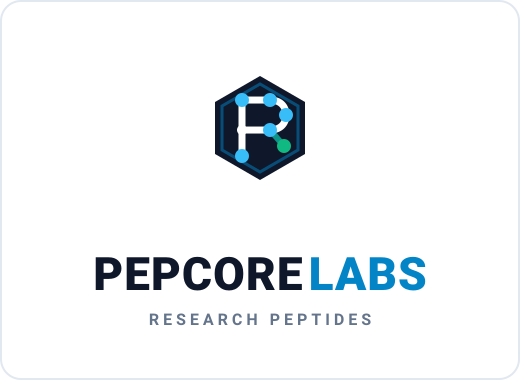

<div align="center">



# Peptide Site

**PepCore Labs — a research-peptide storefront, statically exported and deployed to GitHub Pages.**

<a href="https://acfharbinger.github.io/peptide-site/"></a>
<a href="https://github.com/ACFHarbinger/peptide-site/actions/workflows/ci.yml"></a>
<a href="https://github.com/ACFHarbinger/peptide-site/actions/workflows/deploy.yml"></a>
<a href="https://www.gnu.org/licenses/agpl-3.0"></a>

<br>

<a href="https://nextjs.org/"></a>
<a href="https://react.dev/"></a>
<a href="https://www.typescriptlang.org/"></a>
<a href="https://tailwindcss.com/"></a>
<a href="https://astro.build/"></a>

<br>

<a href="https://vitest.dev/"></a>
<a href="https://testing-library.com/"></a>
<a href="https://mswjs.io/"></a>
<a href="https://www.cypress.io/"></a>
<a href="https://eslint.org/"></a>

</div>

---

## About

PepCore Labs sells research peptides (GLP-1 agonists, growth hormone/antiaging compounds, cosmetic/longevity peptides, healing & recovery, weight-loss stacks, NAD+ blends, and general lab essentials) to qualified researchers in the EU. **Products are for laboratory/research use only** — not for human, veterinary, or household use. That framing (age gate, "Research Use Only" messaging, no dosage/medical-use instructions) is a fixed constraint on this codebase, not just marketing copy: it must be preserved in every catalog, cart, and content surface.

The site is being rebuilt from a static HTML/CSS/vanilla-JS skeleton into a Next.js + TypeScript + React application while keeping the same static-export → GitHub Pages deploy model.

## Tech Stack

- **Framework:** [Next.js](https://nextjs.org/) 14 (App Router, `output: 'export'`) + [React](https://react.dev/) 18 + [TypeScript](https://www.typescriptlang.org/) 5 (`strict: true`)
- **Styling:** [Tailwind CSS](https://tailwindcss.com/) 3
- **State:** [Redux](https://redux.js.org/) / `react-redux` (cart, catalog filters, and other cross-route state)
- **Research/content section:** an [Astro](https://astro.build/) island (`src/frameworks/astro`, built into `public/astro-island`) combined with [Framer Motion](https://www.framer.com/motion/) for the lab-testing/purity and science-background content — kept separate from the main storefront app shell
- **Forms:** [`@tanstack/react-form`](https://tanstack.com/form)
- **Icons:** [lucide-react](https://lucide.dev/)
- **Testing:** [Vitest](https://vitest.dev/) + [Testing Library](https://testing-library.com/) (unit/integration) + [MSW](https://mswjs.io/) (network mocking) · [Cypress](https://www.cypress.io/) (e2e/smoke)
- **Linting:** [ESLint](https://eslint.org/) (`.eslintrc.json` extending `next/core-web-vitals`)
- **Repo automation:** Python 3.11+ / [uv](https://github.com/astral-sh/uv) workspace under `git/` (commit-ticket linking, GitHub Project board sync — see `git/README.md`)

## Project Structure

```
.
├── src/
│   ├── index.html-derived markup, script.js, products.js, style.css
│   │                        # legacy static skeleton, being ported to app/
│   └── frameworks/astro/    # Astro + Framer Motion research/content island
├── assets/
│   ├── svgs/                # generated product "vial" icon SVGs
│   └── icons/               # hand-authored brand/UI icon set
├── scripts/make_vials.py    # one-off generator for the SVGs above
├── stack/next/               # next.config.js, re-exported at the repo root
├── .eslintrc.json            # ESLint config (extends next/core-web-vitals)
├── infra/                   # optional self-host tooling (not used by the
│   ├── docker/               # default GitHub Pages deploy)
│   ├── nginx/
│   ├── ansible/
│   └── terraform/
├── git/                      # local git automation (hooks, backlog sync,
│                              # commit-ticket linking) — see git/README.md
├── .devcontainer/            # Node.js dev container
├── test/
│   ├── unit/                 # Vitest + Testing Library
│   ├── integration/          # Vitest + Testing Library + MSW
│   └── cypress/              # e2e/ + smoke/
└── public/                   # static assets served as-is
```

`app/` (Next.js App Router routes/layouts) doesn't exist yet — the React/TypeScript port is in progress; `src/`'s vanilla `script.js`/`products.js`/`style.css` are the current source of truth for catalog data and cart/age-gate behavior until they're ported.

## Getting Started

Prerequisites: [Node.js](https://nodejs.org/) 20+ and npm.

```bash
git clone https://github.com/ACFHarbinger/peptide-site.git
cd peptide-site
npm install
npm run dev
```

The dev server runs at `http://localhost:3000/` (no `basePath` in development). Production builds use `basePath: /peptide-site` for GitHub Pages.

### Building

```bash
npm run build     # static export to out/
npm run deploy    # build + touch out/.nojekyll
npm start          # serve the out/ export locally
```

## Testing

```bash
npm run lint             # ESLint
npx tsc --noEmit         # type check
npm test                 # Vitest: unit + integration
npm run test:watch       # Vitest in watch mode
npm run test:unit        # Vitest: test/unit/ only
npm run test:integration # Vitest: test/integration/ only
npm run cypress:open     # Cypress e2e + smoke (interactive)
npm run cypress:run      # Cypress e2e + smoke (headless)
npm run cypress:e2e      # Cypress: test/cypress/e2e/ only
npm run cypress:smoke    # Cypress: test/cypress/smoke/ only
```

Cypress runs against a served build — run `npm run build && npm start` (or `npm run dev`) in another terminal first.

## Deployment

Pushing to `main` triggers [`.github/workflows/deploy.yml`](.github/workflows/deploy.yml), which builds the static export and publishes `out/` to the `gh-pages` branch. [`.github/workflows/ci.yml`](.github/workflows/ci.yml) runs lint/typecheck/unit/e2e on every push and PR. Equivalent workflows are mirrored under `.gitlab/`, `.gitea/`, and `.forgejo/` for other forges.

Optional alternatives to GitHub Pages (not used by the default workflow) live under [`infra/`](infra/):

| Path | Purpose |
| --- | --- |
| [`infra/docker/`](infra/docker/) | Build + serve the export with Docker Compose / nginx; placeholder for an optional future orders/checkout API backend |
| [`infra/nginx/`](infra/nginx/) | Standalone nginx configs for the `out/` export |
| [`infra/ansible/`](infra/ansible/) | Deploy the site (and optional backend) on a plain host |
| [`infra/terraform/`](infra/terraform/) | Cloud provisioning placeholder |

## Content constraints

This is a research-use storefront, not a general content site:

- Never introduce human-dosing instructions, medical claims, or language implying products are approved/safe for human consumption.
- Keep the existing "Research Use Only" / EU / age-gate framing consistent across the catalog, cart, and any new content (including the Astro research section).
- Substantial new marketing/product copy should be flagged for review rather than freelanced.

## Git workflow

- Branch from `main`: `feature/<short-description>` or `fix/<short-description>`.
- Small, logical, dependency-ordered commits — one concern per commit. [Conventional Commits](https://www.conventionalcommits.org/) style (`feat(scope): ...`, `fix(scope): ...`, `docs(scope): ...`).
- `pre-commit install` (see `.pre-commit-config.yaml`) runs ESLint (blocking) and `tsc --noEmit` (advisory) before each commit.
- `git/hooks/` (installed via `bash git/hooks/install.sh`) additionally links commits to GitHub Project board tickets — see [`git/README.md`](git/README.md).

## License

[AGPL-3.0](LICENSE)
